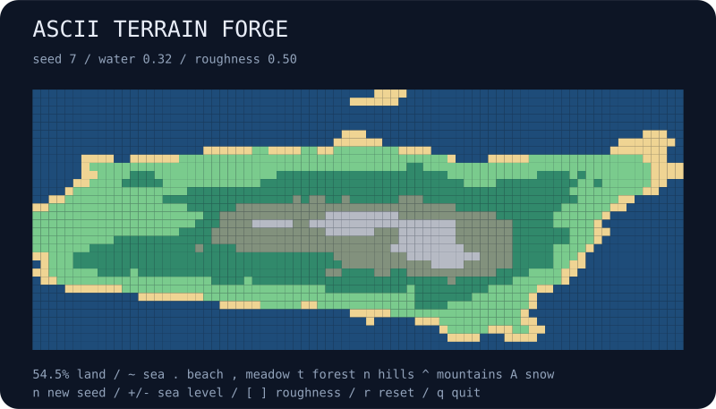

# ascii-terrain-forge

Forge a little island from a seed. Raise the sea, roughen the mountains, or roll another landscape. Export the result as an ASCII map or a portable vector illustration.



## Run

```bash
npx --yes github:b69ca/ascii-terrain-forge
npx --yes github:b69ca/ascii-terrain-forge --seed 137 --roughness 0.7
```

Node.js 20 or newer. No runtime dependencies. Generation runs locally.

## Play

| Key | Action |
| --- | --- |
| `n` | Generate the next seed |
| `+` / `-` | Raise / lower sea level |
| `]` / `[` | More / less roughness |
| `r` | Restore the initial seed, sea level, and roughness |
| `q` or Ctrl-C | Quit and restore the terminal |

Changing sea level recolors the existing height field. Changing roughness regenerates the field using the same seed. The live view redraws on input rather than continuously.

| Symbol | Terrain |
| --- | --- |
| `~` | Sea |
| `.` | Beach |
| `,` | Meadow |
| `t` | Forest |
| `n` | Hill |
| `^` | Mountain |
| `A` | Snow |

Not every island contains every terrain type. Types depend on height relative to the sea level; they are illustrative rather than climate simulation.

## Export and reproduce

```bash
npx --yes github:b69ca/ascii-terrain-forge --seed 7 --width 80 --height 32 --svg island.svg
npx --yes github:b69ca/ascii-terrain-forge --seed 7 --water 0.4 --json
npx --yes github:b69ca/ascii-terrain-forge --seed 7 > island.txt
```

## Options

```text
--seed N          unsigned 32-bit seed (default: 7)
--width N         integer from 8 to 160
--height N        integer from 8 to 160
--water N         sea level from 0 to 1 (default: 0.32)
--roughness N     octave persistence from 0.1 to 0.9 (default: 0.5)
--json            print summary statistics instead of opening the live view
--svg FILE        save a static SVG instead of opening the live view
--no-color        disable ANSI colors
--help            show usage
```

JSON and SVG can be combined. JSON reports configuration, minimum and maximum height, land fraction, and terrain counts; it does not include every height sample. Without a TTY, the CLI prints one plain 80 × 32 map without escape sequences. Live defaults fit the terminal at startup. Specify dimensions to reproduce the same map across terminals. `NO_COLOR=1` also disables colors. Quitting restores the cursor, alternate screen, and input mode. Exit codes are 0 for success and 2 for argument or file errors.

## Under the hood

A seeded lattice hash drives smoothly interpolated value noise. Five octaves are blended with the requested persistence, then a radial falloff produces an island-like shape. Heights are clamped to 0–1. The outer edge is not guaranteed to be entirely water, and the land can contain disconnected islands.

Sea level is applied after generation. Land categories use relative elevation `(height - water) / (1 - water)` with thresholds at 0.05, 0.2, 0.35, 0.5, and 0.65. At sea level 1, every sample is water.

## Library

```js
import { createTerrain, analyze, render, renderSVG } from 'ascii-terrain-forge';
const terrain = createTerrain({ seed: 7, width: 80, height: 32 });
console.log(analyze(terrain));
console.log(render(terrain));
const svg = renderSVG(terrain);
```

`heights` is a row-major `Float64Array`: `heights[y * width + x]`. The exported renderers accept worlds made by `createTerrain()`. The SVG scales to an 800-pixel width while retaining vector geometry.

## Development

```bash
npm ci
npm run check
```

Tests cover deterministic generation, bounds, extreme seeds, sea-level monotonicity, terrain accounting, CLI validation, and SVG output. GitHub Actions runs on Node.js 20, 22, and 24.

## License

MIT
